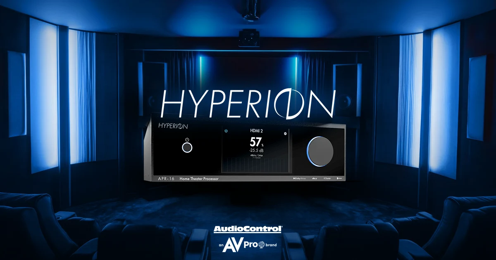

# Unfolded Circle Remote Driver for the AudioControl Hyperion APR-16

[](https://github.com/fattykidd/uc-intg-hyperion/releases)
[](LICENSE)

An integration driver for the **Unfolded Circle Remote 3** and **Remote Two**, written in Python using the official `ucapi-framework`. This driver provides full local network control, real-time diagnostic polling, and system management for the [Hyperion Apr-16](https://www.avproglobal.com/products/acp-hype-apr-16) Immersive Sound Pre-Amp Processor.

---

## Features

- **Media Player**
  - Power on and off.
  - Master volume with up/down stepping and direct level setting, in percent or in decibels (chosen during setup).
  - Mute and mute toggle.
  - Input selection using the custom input names you set on the processor.

- **Audio Mode and Dirac Live Control**
  - **Audio Mode select**: Direct Mode, DTS Neural:X, Stereo, All Channel Stereo, Dolby Mode, Native and Dolby Surround.
  - **Dirac Slot select**: switch between your Dirac Live filter slots using the names you gave them.
  - **Dirac Filtering switch**: turn Dirac correction on and off.

- **Sensors**
  - Dirac active slot and Dirac filtering status.
  - Incoming audio: format, bit depth, sample rate and signal details.
  - Incoming video: format and signal details.
  - Volume (percent and decibels), mute, display brightness, input bass and treble, audio mode, active input, processor temperature (°C) and host IP address.

- **Buttons**
  - Reboot the processor.
  - Trigger an HDMI handshake reset (HPD pulse) to clear HDMI handshake lockups without a power cycle.
  - Bass and treble up/down (1 dB steps) and display brightness up/down (10% steps).

- **Live Sync**
  - The driver polls the processor, so changes made in the processor's own web interface or on its front panel appear on the Remote within a few seconds.

---

## Coming in a future update

These are planned and are **not** available yet:

- Volume safety limits: a power-on default volume and a maximum volume.
- Channel calibration: individual channel level trim.
- Hardware triggers: control of the 12V / 5V trigger outputs and voltage mode.
- EDID: global EDID toggling and per-input EDID status.
- Firmware and build information, and an overall system health status.

---

## Deployment Options

### Option 1: Docker Container

The driver is continuously compiled into multi-architecture Docker container images targeting `linux/amd64` and `linux/arm64` via GitHub Actions and hosted on GitHub Container Registry (`ghcr.io`).

#### Using Docker Run
```
docker run -d \
  --name uc-hyperion-apr16 \
  --restart unless-stopped \
  --net host \
  ghcr.io/fattykidd/uc-intg-hyperion:latest
  ```

#### Using Docker Compose
```
uc-intg-hyperion:
    image: ghcr.io/fattykidd/uc-intg-hyperion:latest
    container_name: uc-intg-hyperion
    restart: unless-stopped
    network_mode: host
    volumes:
      - ./hyperion/data:/data  # Persistent configuration storage
    environment:
      - UC_CONFIG_HOME=/data
      - UC_INTEGRATION_INTERFACE=0.0.0.0
      - UC_INTEGRATION_HTTP_PORT=9090
      - UC_DISABLE_MDNS_PUBLISH=false
      - PYTHONPATH=/app

```

### Option 2: Install on the Remote (no Docker)

Each release includes a ready-to-install archive for the Remote, built as a static `aarch64` binary. It runs on the Remote itself, so you don't need a separate server or container.

**Using Integration Manager (recommended).** [Integration Manager](https://github.com/JackJPowell/uc-intg-manager) installs custom integrations from the community registry and keeps them up to date. Find **AudioControl Hyperion APR-16** under *Available Integrations* and click Install. When you update through the manager, it backs up your device configuration first and restores it afterwards.

**Installing manually.**
1. Download `uc-intg-uc_intg_hyperion-<version>-aarch64.tar.gz` from the [latest release](https://github.com/fattykidd/uc-intg-hyperion/releases/latest).
2. In the Web Configurator, open **Integrations**, then **Add new** and **Install custom**.
3. Choose the downloaded `.tar.gz` file and upload it.
4. Once it is installed, continue with **Integration Setup** below. The Remote starts the driver itself, so you don't enter a driver address.

Requirements: Remote 3 or Remote Two with firmware 1.9.0 or newer (2.9.3 or newer for in-place updates). The Remote allows up to 10 custom integrations in total.

If you run a copy of the driver in Docker as well, stop one of them first, because both advertise the same driver name.

## Integration Setup (Unfolded Circle Remote)


1. Open the Unfolded Circle Web Configurator or Remote UI.

2. **Docker or a separate host:** go to Integrations -> Add new -> Add new Integration -> choose Websocket / Network Integration, and enter the IP address and port (9090) where the driver is running.
   **Installed on the Remote:** the driver is already listed after installation. Select it and continue.

3. In the setup prompt, enter the local IPv4 address or hostname of your AudioControl Hyperion APR-16 processor.

4. The Remote will discover and register all entities automatically (Media Player, Selects, Switches, Sensors, and Buttons).

## Troubleshooting

### The Option field is empty when I add a select command to a button
The select entities (Audio Mode, Dirac Slot) and the media player's input list send their options to the Remote as soon as the entity is added. If the **Option** field of a button's *Select option* command still shows a plain text box, the web configurator is probably showing an old cached copy of the entity list. Hard-reload the page (**Ctrl+F5**, or **Cmd+Shift+R** on macOS), clear the browser cache if that is not enough, and open the command editor again. The dedicated **Select** widget does not need this.

### The driver exits with `NonUniqueNameException`
Another copy of the driver is already advertising itself on the network under the same name (`uc_intg_hyperion`). Stop the other instance, such as an old container, a second host, or a copy you started for testing, and start the driver again. `docker ps -a` lists containers that are still present.

### The Remote cannot find the driver
- Check that the container is running (`docker ps`) and that port **9090** is reachable from the Remote.
- If the Remote does not discover the driver automatically, add it manually with `ws://<driver-host-ip>:9090`.
- With `network_mode: host`, make sure nothing else on the host is already using port 9090.

### Entities show *Unavailable* or *Unknown*
- Entities become unavailable when the driver cannot reach the processor. Check that the processor is powered on and that its address and port (default 8080) in the integration settings are correct.
- Some values, such as the Dirac slot and Dirac filtering state, show *Unknown* until the first successful read from the processor after the driver connects.

### Changes made in the processor's web interface are slow to appear
The driver polls the processor every 5 seconds and refreshes the full state every 30 seconds. Power, volume, mute, input, audio mode, Dirac state and the audio format, bit depth and sample rate follow within about 5 seconds. Other sensors, such as temperature, video format, bass, treble and display brightness, are read every 30 seconds.

### The bit depth and sample rate sensors show "No Signal"
The processor reports a bit depth and sample rate of 0 when no audio is playing. The sensors show *No Signal* until audio starts.

### The audio format sensor shows PCM for a bitstream such as Dolby TrueHD Atmos
That is what the processor itself reports for the audio format. Use the **Audio Signal** sensor for the codec detail (for example, *Dolby Atmos*).

### Dirac slot names look wrong
The processor has three Dirac slots, numbered 0 to 2, and the driver shows the names you gave them in the Dirac Live software. If the names look wrong, run the integration setup again so they are read afresh.

### Getting the driver log

**Docker:**
```
docker logs --timestamps --since 30m <container-name>
```

**Installed on the Remote:** the Remote stores everything the driver writes to its output, with timestamps, alongside the system logs.
- In the Web Configurator, go to **Settings → Development → Logs** and download the log.
- With firmware 2.1.0 or newer you can also turn on the Remote's live log viewer: `curl -X PUT http://<remote-ip>/api/system/logs/web -u "web-configurator:<PIN>" -H "Content-Type: application/json" -d '{"enabled": true}'`, then open `http://<remote-ip>/log/`. It is off by default and uses a lot of the Remote's memory reserved for custom integrations (about 170 MB), so turn it off again when you are done by sending `{"enabled": false}`.

### Reporting a problem
Please open an issue at <https://github.com/fattykidd/uc-intg-hyperion/issues> and include:
- the driver version, the Remote firmware version and the processor firmware version;
- what you did and what you expected to happen;
- the driver log from around the time of the problem (see **Getting the driver log** above).

The log contains your processor's IP address. Remove it first if you would rather not share it.

## Acknowledgments & Attribution

* **[Jack Powell](https://github.com/JackJPowell)** — For creating and maintaining the foundational Python driver framework ([`ucapi-framework`](https://github.com/JackJPowell/ucapi-framework)) and integration template ([`uc-intg-template`](https://github.com/JackJPowell/uc-intg-template)).
* **[Unfolded Circle](https://unfoldedcircle.com/)** — For creating an exceptional smart remote ecosystem and flexible open API architecture.
* **[AudioControl](https://www.audiocontrol.com/)** — For engineering high-end home theater processing hardware.
* **The Open-Source Community** — To all the independent developers and hobbyists whose dedication fuels custom integrations and ecosystem expansion.
* **Gemini** — For collaborative architecture, driver design, and implementation support throughout development.